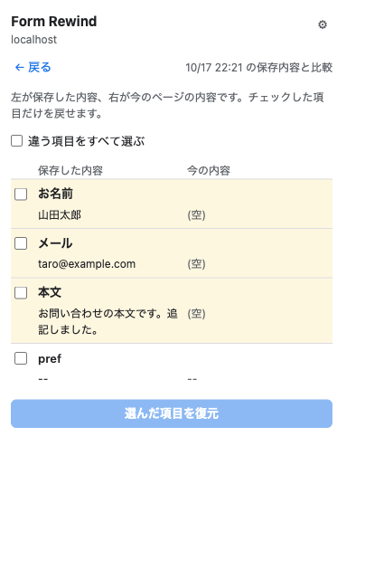

# Form Rewind

フォームの入力内容を自動で保存し、消えてもワンクリックで取り戻せる Chrome 拡張 (MV3)。

ページを閉じた・再読み込みした・送信に失敗した、で消えた入力を復元できます。
履歴から「今の入力との差分」を見て、項目ごとに戻すこともできます。
同じ内容を何度も入れるフォームには「すべてのフィールドを保存」とオートロードが使えます。

**外部への通信はしません。** 通信するコードを持たず、拡張機能ページの CSP でも
`connect-src 'none'` にしています。

 

## できること

### 自動保存と復元

- **初期状態では自動保存しません。** ポップアップの「このサイトでは自動保存する」で選んだサイトだけ保存します。
  設定画面で「すべてのサイトで入力内容を自動で保存する」をオンにすると全サイトで保存し、
  ポップアップの項目は「このサイトでは自動保存を一時停止する」に変わります。
- 入力が止まって 1 秒後に保存します (打ち続けていても 10 秒ごと)。
- 保存した内容があるページを開き直すと、右下に「以前の入力内容が保存されています」と出ます。
  **今のページにすでに同じ内容が入っているときは出しません。**
- 復元したあと「元に戻す」で、復元前の状態へ戻せます。上書きされる直前の入力も履歴に残ります。
- iframe の中のフォームも保存・復元できます。

### 履歴・差分・固定

- ツールバーのポップアップに、そのページの履歴が新しい順に並びます。
- 「差分」で保存時と今の内容を並べて見られます。チェックした項目だけを戻せます。
- 「固定」で名前を付けると、件数や日数の上限で消えなくなります。
  「このサイト全体で使う」にすると、同じサイトの別ページでも呼び出せます。

### すべてのフィールドを保存 / オートロード

AutoFormer+ と同じ考え方の、手動で保存する定型入力です。

- **すべてのフィールドを保存**: 表示中の欄の値を、サイト (オリジン) ごとに 1 組保存します。
  `フォーム名@欄の name` をキーにして欄ごとに上書きするので、同じ name の欄なら
  **同じサイトの別ページでも読み込めます**。
- **すべて読み込む**: 保存した値を入れます。**Shift を押しながら**クリックすると空欄だけに入れます。
- **オートロード** (初期値オン): ページを開いたときと、あとから入力欄が描かれたときに、
  保存した値を自動で入れます。**すでに入力のある欄は上書きしません。**
- **保存内容を見る・編集**: 保存した値を別画面の表で確認できます (Lightning AutoFill の
  Form Fields 画面と同じ形)。値の編集・項目の削除のほか、「自動」を外すと、その項目は
  オートロードでは入れず、手動の読み込みでだけ入れるようになります。
  ポップアップと設定画面から開けます。
- 同じ画面で、保存した内容を **JSON でエクスポート / インポート**できます (全サイト分を1ファイル)。
  インポートはサイトごとに今の内容へ統合し、同じ項目はファイルの内容で上書きします。
- 読み込んだ項目数は、ツールバーのアイコンに**青いバッジ**で出ます。
  iframe の分も合計し、ページを開き直すと数え直します。それ以外のときは、
  履歴のあるページに青い ● が付きます。
- ショートカットは登録してありますがキーは割り当てていません。
  `chrome://extensions/shortcuts` で割り当てられます。


## 保存しないもの

- パスワード欄 (`type="password"`、`autocomplete="current-password"` / `"new-password"`)
- hidden・ファイル選択・ボタン
- 検索ボックス (検索のたびに履歴が増え、どのサイトでも復元バナーが出てしまうため)

カード番号やワンタイムコードなどは保存します。保存してよいかは使う人の判断に任せています。

## データの置き場所

すべてこのブラウザの中です。

| 何を | どこに |
| --- | --- |
| 入力履歴・すべてのフィールドを保存した値 | 拡張機能の IndexedDB (サイト側の JavaScript からは読めない) |
| 設定 | `chrome.storage.local` |

暗号化はしていません。ディスクを直接読まれる脅威には、OS のディスク暗号化
(macOS なら FileVault) で備えてください。理由は `.claude/skills/form-rewind/SKILL.md` に書いています。

履歴は 1 ページあたり 20 件・30 日で古いものから消えます (設定で変更可。固定したものは消えません)。

## インストール

1. このリポジトリを clone する
2. `chrome://extensions` を開き、右上の「デベロッパーモード」をオンにする
3. 「パッケージ化されていない拡張機能を読み込む」でこのフォルダを選ぶ

## テスト

```sh
PLAYWRIGHT_SKIP_BROWSER_DOWNLOAD=1 npm install
npm test
```

Playwright で Brave Browser Nightly を起動して E2E を回します (通常の Chrome は
`--load-extension` を無視するため)。

## ライセンス

MIT
